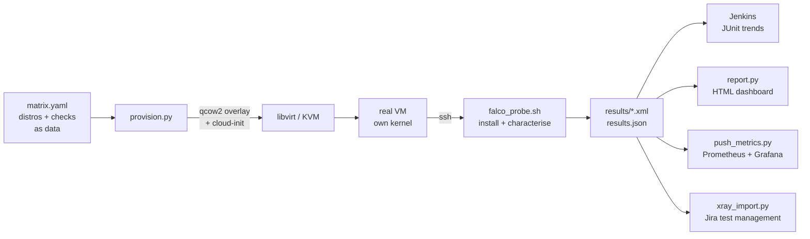

# kernel-matrix

A Jenkins-driven Linux kernel compatibility matrix. Boots real virtual machines
across distributions, installs [Falco](https://falco.org) — an open-source eBPF
security agent — and records **which driver it selected, what it cost, and
whether it actually detected anything.**

Built as a learning project to answer a question properly rather than
theoretically: *how do you test software across dozens of distro and kernel
combinations?*

---

## Why virtual machines and not containers

This is the decision the whole project rests on.

**Containers share the host kernel.** A container labelled "RHEL 9" gives you
RHEL 9 *userspace* — its glibc, its package manager, its filesystem layout —
running on whatever kernel the host happens to be booted into. If what you are
testing depends on the kernel, a container is lying to you by omission.

For an endpoint security agent the kernel is not incidental, it is the system
under test. Falco observes process activity by hooking into the kernel, and
which mechanism it can use is a direct function of kernel version:

| Fixture | Own kernel? | What it can actually test | Cost |
|---|---|---|---|
| Container | No, shares the host's | Userspace, packaging, install paths | Seconds, free |
| **Virtual machine** | **Yes** | **Kernel version, eBPF/BTF availability, driver selection** | Minutes, real money |
| Bare metal | Yes, plus real hardware | Secure Boot, TPM, honest performance | Slow, scarce |

The design principle underneath: **match fixture cost to the risk you are
actually buying down.** Reaching for the cheap fixture when only the expensive
one is valid is how teams ship bugs they believed were covered.

---

## What it measures

Falco picks its engine at runtime based on what the kernel supports, and
**the fallback is silent**. A pass/fail matrix would show all green while
hiding three very different realities:

| Driver | Requires | Notes |
|---|---|---|
| `modern_ebpf` | Recent kernel + BTF | CO-RE. The good path. |
| `ebpf` | eBPF support | Legacy probe, not portable across kernels |
| `kmod` | Kernel headers | Kernel module. Most invasive fallback. |

For each kernel the probe records driver selection, install time, time to
active, idle RSS and CPU, whether a synthetic event was detected, and time to
first alert. Plus six declarative checks (kernel version, kernel floor, BTF,
systemd, module list, package manager) declared as data in
[`matrix.yaml`](matrix.yaml).

---

## How it fits together



The lifecycle is borrowed from [Molecule](https://ansible.readthedocs.io/projects/molecule/),
which borrowed it from common sense: **create → prepare → converge → verify →
destroy**, with teardown in a `finally` block so it happens even on failure.

Disk stays cheap through qcow2 backing files. One base image is downloaded per
distro and treated as read-only; each VM gets a thin overlay storing only its
own writes. Ten VMs from one 600 MB base cost roughly 600 MB plus a couple of
hundred megabytes each, not 6 GB.

---

## Quick start

```bash
sudo apt install -y libvirt-daemon-system libvirt-clients virtinst qemu-kvm \
                    cloud-image-utils genisoimage python3-yaml
sudo usermod -aG libvirt,kvm $USER          # log out and back in
```

```bash
python3 provision.py --list                 # what is in the matrix
python3 provision.py --distro ubuntu-22.04 --keep
```

Then the payoff — two kernels, one machine:

```bash
uname -r                                    # host:  7.0.0-28-generic
ssh -i ~/.ssh/id_ed25519_kmatrix ubuntu@<vm-ip> uname -r
                                            # guest: 5.15.0-187-generic
```

Full matrix with characterisation:

```bash
python3 provision.py --tier fast --falco
python3 report.py
python3 push_metrics.py --gateway http://localhost:9092
```

Dashboards:

```bash
cd observability && cp .env.example .env && docker compose up -d
```

| Service | Port | What |
|---|---|---|
| Report | 8087 | Self-contained HTML, no dependencies |
| Grafana | 3002 | Trends across runs |
| Prometheus | 9091 | Metric store |
| Pushgateway | 9092 | Batch jobs push here; Prometheus scrapes it |

---

## Things that actually broke

Kept because every one is an environment problem rather than a code problem,
which is the whole reason "works on my machine" is an engineering issue and
not a joke.

| Symptom | Cause |
|---|---|
| Works by hand, fails in CI | `virsh` resolves to `qemu:///session` in non-interactive shells — no default network, no DHCP. Pinned `LIBVIRT_DEFAULT_URI`. |
| `apt` says PyYAML is installed, Python disagrees | A `~/.local/bin/python3` shadowing the system interpreter in login shells only |
| `Permission denied` on the disk image | `libvirt-qemu` cannot traverse a mode-750 home directory. `setfacl -m u:libvirt-qemu:x` |
| Debian VM boots, never gets an IP | `genericcloud` is the stripped-down cloud build. `generic` is the one with drivers. The naming is backwards from intuition. |
| Jenkins repo key rejected | The `jenkins.io-2023.key` in every guide online expired in March 2026 |
| `dubious ownership in repository` | Git refuses repos owned by another user since CVE-2022-24765 |
| Falco crash-loops on Debian 11, every engine | The packaged container plugin (`libcontainer.so`) needs a glibc resolver symbol (`__res_search`) older distros don't expose. The plugin loads before any engine opens, so it takes down modern eBPF, legacy eBPF, and kmod identically — looking exactly like a kernel incompatibility. Disabled the plugin; then the default ruleset *also* had to go, because its rules reference `container.*` fields that no longer exist without it. Replaced with one self-contained rule. |
| Probe reports `started: true` during a crash loop | `systemctl list-units --state=active` catches the fraction of a second between restart and crash. One lucky sample and a dead sensor reports as healthy — with `driver` guessed from the unit name. Now requires three consecutive running samples. |
| `driver: unknown`, rss 0, no detection — but Falco works fine | `falco-kmod-inject.service` is a oneshot helper that sorts alphabetically before `falco-kmod.service` and stays `active (exited)` forever. The probe grabbed it with `head -1` and read the wrong unit's journal from then on. Filter on sub-state `running`, not state `active`. |
| All Falco units refuse to load on Ubuntu 18.04 | Upstream unit files say `ExecReload=kill -1 $MAINPID` — a non-absolute path. systemd 239+ resolves it from `$PATH`; systemd 237 rejects the entire unit with `Exec format error`. A drop-in can't fix it because the base file still fails to parse. `sed` the unit files to `/bin/kill`. |
| `yum install falco` fails on CentOS 7 | Falco 0.41.0+ links against `GLIBC_2.28`; EL7 ships 2.17. The repo keeps every release, and walking versions down found 0.40.0 is the last that installs — turning the row from "install failed" into "last known good sensor version for this platform". Also: `dkms` lives in EPEL on EL7, not base. |

---

## Evidence bundles and fault injection

Every Falco run leaves `results/evidence/<distro>/`: journal, package logs, install
scripts, kernel capabilities, plugin linkage, each section headed by the command that
produced it, plus a `manifest.json` (outcome, git SHA, build, sha256 per file). Jenkins
archives them, so a red row can be diagnosed without re-running it.

A natural failure has no answer key until someone root-causes it. A fault applied on
purpose does, which makes it a labelled case for
triage benchmarks (can a model, or a script, diagnose the failure from the bundle?):

```bash
python3 provision.py --list-faults
python3 provision.py --distro debian-12 --falco --fault exec_permission
```

Each fault in `faults.yaml` runs as root between install and start, silently, and names
the check it must break. If that check stays green the fault did not take effect: the run
exits 1 and the bundle is marked ineffective, so it never becomes a labelled case. Fault
runs write to `results/faults/`, never into `results.json` or the dashboard.

---

## Package qualification

`provision.py --falco` answers "does Falco run on this kernel?" and repairs known
packaging bugs so the driver can still be measured. `qualify.py` answers the release
question instead: does the actual `.deb`/`.rpm` install through the package manager, with
its maintainer scripts running, on real distro kernels, in every way a fleet installs it?

Upstream's package tests extract the tarball with `cp -r * /`, so `postinst` never runs
in CI. falcosecurity/falco#3994 (0.45.0 fresh installs fail on kernels without modern
eBPF) shipped through exactly that gap, days after 0.45.0-rc3 and rc4 sat in the dev repo.

```bash
python3 qualify.py --dry-run                     # plan, and check every package URL exists
python3 qualify.py                               # versions x targets x scenarios, 4 VMs at a time
python3 qualify.py --version 0.45.1-rc1 --target ubuntu-20.04 --scenario fresh-auto
python3 qualify.py --matrix-only                 # rebuild matrix.json and print the grid
```

The grid is data in [`qualification.yaml`](qualification.yaml): versions (release
candidates resolve to Falco's dev repo), targets from `matrix.yaml`, and four scenarios:
fresh install with `FALCO_DRIVER_CHOICE` auto, kmod and modern_ebpf, and an in-place
upgrade from N-1 with `--force-confdef --force-confold`.

Build prerequisites are a gate, not a best effort: `build_prereqs.sh` makes sure dkms,
make, gcc and the running kernel's headers are present before the package goes in, and a
cell where they cannot be met is a harness `error`, never a package `fail`. The first grid
without it reported kmod failures on debian-11 and rocky-8 that were really the host: dkms
lives in EPEL on EL8/9, and Debian 11's security repo 404s the headers for the cloud
image's kernel since its LTS ended (repointed at archive.debian.org, like CentOS 7's vault).
If the archive has no headers for the image's kernel at all, the gate moves to the kernel
the archive does carry and reboots into it.

The probe runs **strict**: it installs the package file it was given, never the repo's
copy, and repairs nothing. Four checks, all decided by code from what the guest reports:

| Check | Passes when |
|---|---|
| `pkg_installed` | package manager exit 0, package fully configured (not `half-configured`), no maintainer script reported failure (dnf only warns), requested version |
| `driver_loaded` | `/sys/module/falco` exists, or the running sensor holds BPF programs (`/proc/<pid>/fd`) |
| `service_active` | an engine unit is running, stable for 3 samples, started by the maintainer scripts alone |
| `event_detected` | a read of `/etc/shadow` raised an alert |

A cell is `pass`, `fail` (first failed check, with what was seen), `unsupported`
(modern_ebpf on a kernel that cannot run it, with the package still configured cleanly),
`blocked` (the N-1 package never installed, so no upgrade was attempted) or `error` (the
harness could not ask: no VM, wrong kernel, no prerequisites, no probe data). Secure Boot
state is recorded per cell, not judged: under Secure Boot the kernel rejects an unsigned
dkms module, so a red kmod cell on such a host can be the host's policy (rocky-9 boots UEFI,
and libvirt's firmware autoselection enables Secure Boot).

Kernel variants test whether a failure follows the kernel or the distro: `ubuntu-20.04-hwe`
is the same release booted on its 5.15 HWE kernel, installed in the VM and rebooted into
(`install_kernel_variant` in provision.py), with `kernel_version_matches_expectation`
proving the reboot took.

Output, per version, plus one file for a dashboard:

```
results/qualification/<version>/<distro>--<kernel>--<scenario>.json
results/qualification/<version>/evidence/<cell>/    bundle, incl. install.log and falcoctl config
results/qualification/<version>/logs/<cell>.log
results/qualification/matrix.json                   every cell: status, checks, links to result + evidence
```

The first run (0.45.0, 0.45.1-rc1, 0.45.0-rc4) and what it found: [`QUALIFICATION.md`](QUALIFICATION.md).

---

## Layout

```
matrix.yaml          the compatibility matrix, as data not code
provision.py         boot, wait, check, characterise, destroy
falco_probe.sh       runs inside the guest; emits JSON
collect_evidence.sh  runs inside the guest after the probe; read-only evidence bundle
faults.yaml          deliberate, verified breakage for labelled triage cases
qualify.py           package qualification: version x distro/kernel x scenario
qualification.yaml   the qualification grid, as data
build_prereqs.sh     runs inside the guest before a qualification probe; dkms, gcc, headers
QUALIFICATION.md     what the first qualification grid found
report.py            results.json -> self-contained HTML; archives every run,
                     diffs against the previous one ("vs last run" column),
                     and checks GitHub for untested upstream Falco releases
push_metrics.py      results.json -> Prometheus Pushgateway
xray_import.py       JUnit -> Jira/Xray, one environment per kernel
Jenkinsfile          preflight -> lint -> parallel matrix -> publish
observability/       docker compose: Prometheus, Grafana, Pushgateway, nginx
```

---

## Notes and limitations

- Falco stands in for a proprietary endpoint sensor. It is a genuine eBPF
  security agent with the same kernel-dependency profile, and it is free.
- The matrix is tiered deliberately. Real VMs cost real time, so cheap checks
  gate first, a small fast tier runs per build, and the full sweep runs
  nightly. That ordering is the point, not an optimisation.
- Six distros currently. Adding one is a few lines of YAML, by design.
- Built and tested on a single bare-metal host with KVM. The production shape
  would be a disposable Jenkins controller with a labelled `kvm` build agent,
  so only the machine that needs privileged access has it.
